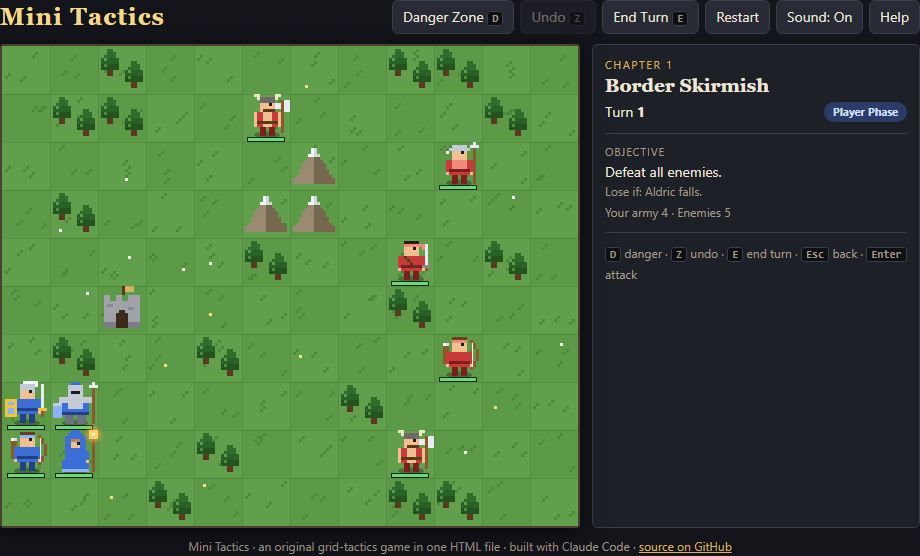
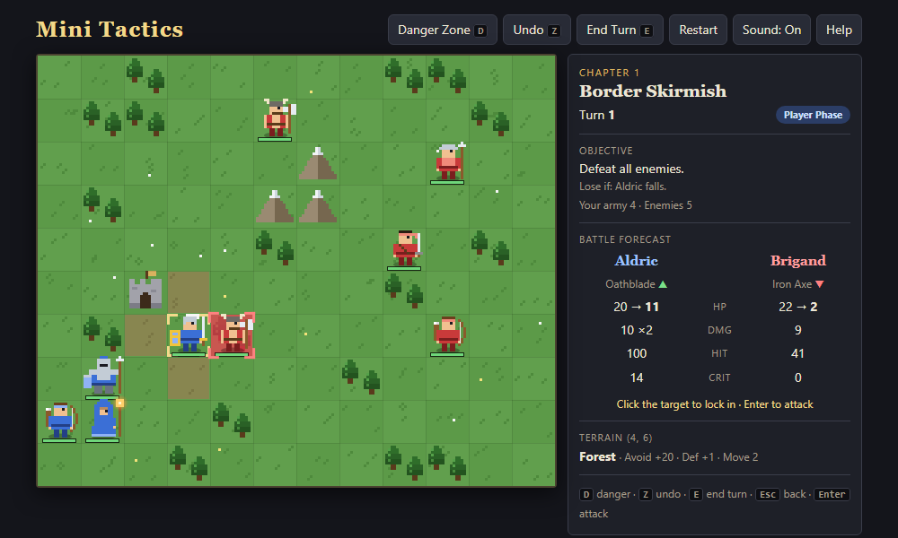
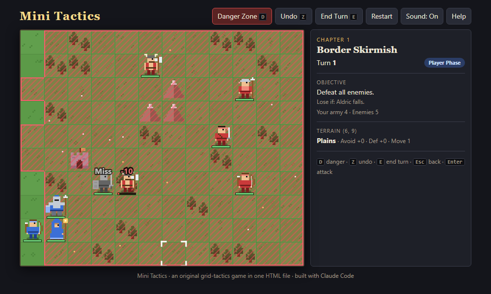

# Mini Tactics

A three-chapter medieval grid-tactics game, in the style of the Game Boy Advance tactics classics, that runs from a
**single HTML file**. It has no install, no build step, no images or sound files: everything (including the pixel-art
sprites) is drawn in code.

**▶ Play it: https://charcharbean.github.io/mini-tactics/**



## The campaign

Brigands raid the marches of Eastmarch. Lead Aldric (Lord), Brenna (Knight), Wren (Archer) and Maelis (Mage)
through three battles, each teaching one idea:

| Chapter | Objective | Teaches |
| --- | --- | --- |
| 1. Border Skirmish | Defeat all 5 brigands | Movement, the weapon triangle, the battle forecast |
| 2. Hold the Bridge | Survive 8 turns; don't let an enemy end its turn on the gate | The danger zone |
| 3. Castle Seize | Defeat Warlord Garrick and seize his throne | Assaulting a fortified position |

If Aldric falls, the chapter is lost and restarts. Units that survive a chapter get stronger.

## How to play

| Input | Action |
| --- | --- |
| Click a blue unit | Select it: blue tiles show where it can move, red shows what it can hit |
| Click a blue tile | Move there, then choose **Attack**, **Vulnerary**, **Seize** or **Wait** |
| Hover / click a red target | Show the battle forecast; click again (or press `Enter`) to attack |
| Click an enemy | Show just that enemy's movement and attack range |
| Right-click or `Esc` | Go back a step (cancels a move you haven't confirmed) |
| `D` | Toggle the danger zone: every tile any enemy could attack next turn |
| `Z` | Undo your last action this turn. Dice rolls are seeded, so undo can't reroll a miss |
| `E` | End your turn |

<p>
  
  
</p>

### Rules in brief

- **Weapon triangle:** Sword beats Axe, Axe beats Lance, Lance beats Sword (+1 Attack, +15 Hit for the winner).
- **Damage** = Attack − Defense (Resistance against magic) − terrain Def. Critical hits deal triple damage.
- **Hit chance** uses two random numbers averaged together, like the GBA games: a displayed 90% really lands about 98%
  of the time, and a displayed 30% about 18%.
- A unit with **4+ more Speed** strikes twice. Defenders **counter** if the attacker is within their weapon range, and
  bows can't counter up close.
- **Terrain** matters: forests, forts, mountains and the throne add Avoid and Defense; forts, the gate and the throne
  heal 20% HP each turn.

## Run it locally

Download `index.html` and double-click it. That's it.

## Tests

The game ships with a Playwright test suite that checks the combat formulas against hand-computed values, the
2-random-number hit system (10,000 rolls), movement rules, enemy AI behaviors, undo's anti-reroll rule, every win and
loss condition, and a full clicked-through turn with zero console errors.

```bash
npm install
npx playwright install chromium
npm test
```

## How it was built

This game was built with [Claude Code](https://claude.com/claude-code) from a written design spec,
[`PLAN.md`](PLAN.md). The spec defines the rules, stats, maps and features, splits the work into 8 build phases with
a check for each, and ends with the kickoff prompt used to start the build. The **Decisions** and **Playtest notes**
sections at the bottom of `PLAN.md` record how ambiguities in the spec were resolved and how each chapter played in
automated playtests.

The code in `index.html` is organized into numbered sections (data, RNG, combat, pathing, level setup, undo,
animation, player phase, enemy AI, win/loss, screens, input, sound, rendering, test hook). All combat formulas live
in one place, so the forecast and the actual battle can never disagree.

## Credits

Game mechanics (grid tactics, weapon triangle, GBA-style combat math) are inspired by classic handheld tactics RPGs;
all names, characters, story and art are original. Formula and AI references are listed in
[`PLAN.md`](PLAN.md#sources-and-references).

Licensed under the [MIT License](LICENSE).
